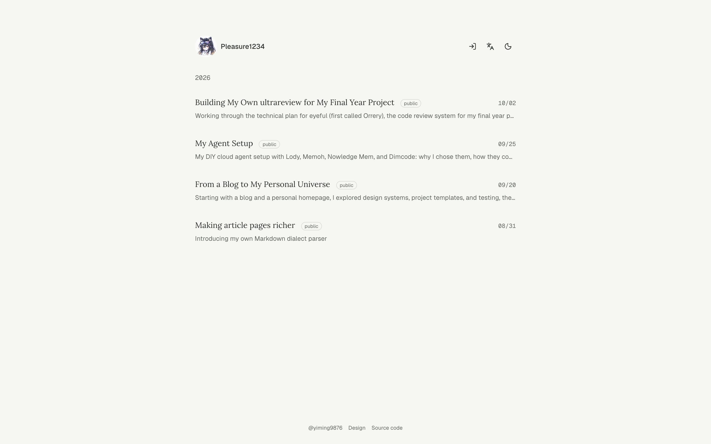

<div align="center">
  <h1>my knowledge</h1>
  <p>A quiet blog built around finished writing.</p>
  <p><a href="https://knowledge.you-find.me">knowledge.you-find.me</a></p>
</div>

<picture>
  <source media="(prefers-color-scheme: dark)" srcset="docs/assets/screenshot-dark.jpg">
  
</picture>

## Features

- **Focused reading** — narrow pages, shareable links, light and dark themes
- **Expressive Markdown** — math, footnotes, diagrams, repository cards and media
- **Multilingual** — Chinese, with optional English and Japanese editions
- **Open API and MCP** — `https://knowledge.you-find.me/api/mcp`, signed in through you-find.me

## Develop

```sh
pnpm install
cp apps/web/.env.example apps/web/.dev.vars
pnpm dev
```

TanStack Start on Cloudflare Workers, with R2, D1 and KV · [Documentation](docs/README.md)

Apache-2.0 · Part of [Vesper](https://github.com/vesper-shop)
